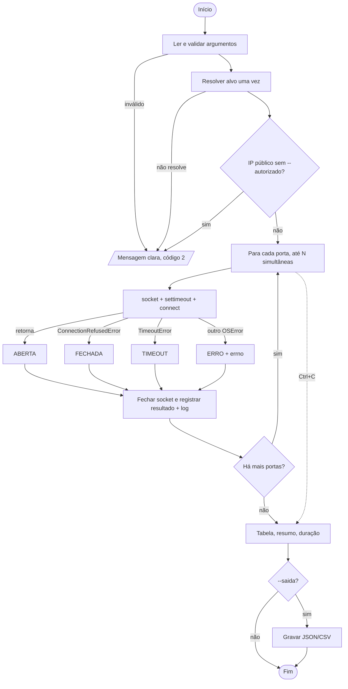

# Planejamento do scanner (Roteiro 4, seção 2)

> Etapa feita **antes** da implementação: estratégia, recursos do Python investigados e lógica do programa.

## 1. Estratégia

Scanner **TCP Connect**: para cada porta, o programa pede ao sistema operacional que abra uma conexão TCP
(`socket.connect()`). O SO executa o *three-way handshake* e o programa apenas **interpreta o desfecho**.
Não há pacotes forjados nem privilégios especiais (raw sockets), e nenhuma biblioteca faz o scan por nós.

| Desfecho da tentativa | O que aconteceu na rede | Exceção em Python | Estado no programa |
|---|---|---|---|
| Conexão estabelecida | SYN → SYN/ACK → ACK | nenhuma (`connect` retorna) | `ABERTA` |
| Conexão recusada | SYN → **RST** | `ConnectionRefusedError` | `FECHADA` |
| Sem resposta no prazo | SYN sem retorno (descartado, perdido, lento) | `TimeoutError` (`socket.timeout`) | `TIMEOUT` |
| Outra condição | ICMP "inalcançável", sem rota, falta de recursos... | outro `OSError` (usa `errno`) | `ERRO` |

## 2. Recursos da biblioteca `socket` investigados

| Recurso | Para que serve aqui |
|---|---|
| `socket.socket(familia, SOCK_STREAM)` | cria um socket TCP (IPv4 ou IPv6) |
| `sock.settimeout(seg)` | **controla o tempo de espera** do `connect()`; ao estourar levanta `TimeoutError` |
| `sock.connect((ip, porta))` | dispara o handshake; sucesso = porta aceitou a conexão |
| `socket.getaddrinfo()` | resolve hostname → IP **uma única vez** (e acusa endereço inválido via `gaierror`) |
| `socket.getservbyport()` | nome "normalmente associado" à porta (informativo; não confirma o serviço) |
| `with socket.socket(...)` | garante `close()` mesmo em erro (libera o recurso) |
| `errno` | nome técnico do erro (`ENETUNREACH`, `EHOSTUNREACH`...) |

## 3. Pseudocódigo

```text
ler argumentos (alvo, portas, timeout, workers, saída, log)
validar:  portas em 1..65535 | intervalo início <= fim | timeout > 0 | workers 1..100
resolver o alvo UMA vez  -> se falhar: mensagem de erro e sair (código 2)
se o IP é público e não houve --autorizado: recusar (código 2)

resultados = []
para cada porta p, em até N threads simultâneas:
    t0 = agora()
    tente:
        abrir socket TCP; settimeout(timeout); connect(ip, p)
        estado = ABERTA
    exceto ConnectionRefusedError:  estado = FECHADA
    exceto TimeoutError:            estado = TIMEOUT      # NÃO é "fechada"
    exceto OSError como e:          estado = ERRO (errno de e)
    sempre: fechar socket
    resultados += (alvo, p, estado, serviço, agora()-t0, detalhe)
    # qualquer falha numa porta NÃO interrompe as demais

se Ctrl+C: cancelar as portas pendentes e seguir para a apresentação (parcial)
imprimir tabela (alvo, porta, resultado...) + resumo + duração
se --saida: gravar JSON/CSV;  se --log: cada tentativa já foi registrada
```

## 4. Fluxograma



## 5. Questão para análise — por que uma tentativa de conexão TCP investiga a disponibilidade de uma porta?

Porque o TCP exige um **handshake** antes de qualquer dado, e a resposta de quem recebe o SYN depende do
estado da porta: se há um processo em `LISTEN`, a pilha TCP do destino responde **SYN/ACK**; se não há,
responde **RST**; se um firewall filtra, **nada volta**. Cada resposta (ou a ausência dela) é observável
pelo cliente sem enviar nenhum dado de aplicação. A tentativa de conexão é, portanto, uma pergunta
("você aceita conexões nesta porta?") cuja resposta revela o estado — com a ressalva de que ela só diz que a
**conexão foi aceita naquele momento e naquelas condições**, não qual serviço está ali nem se ele é vulnerável.
